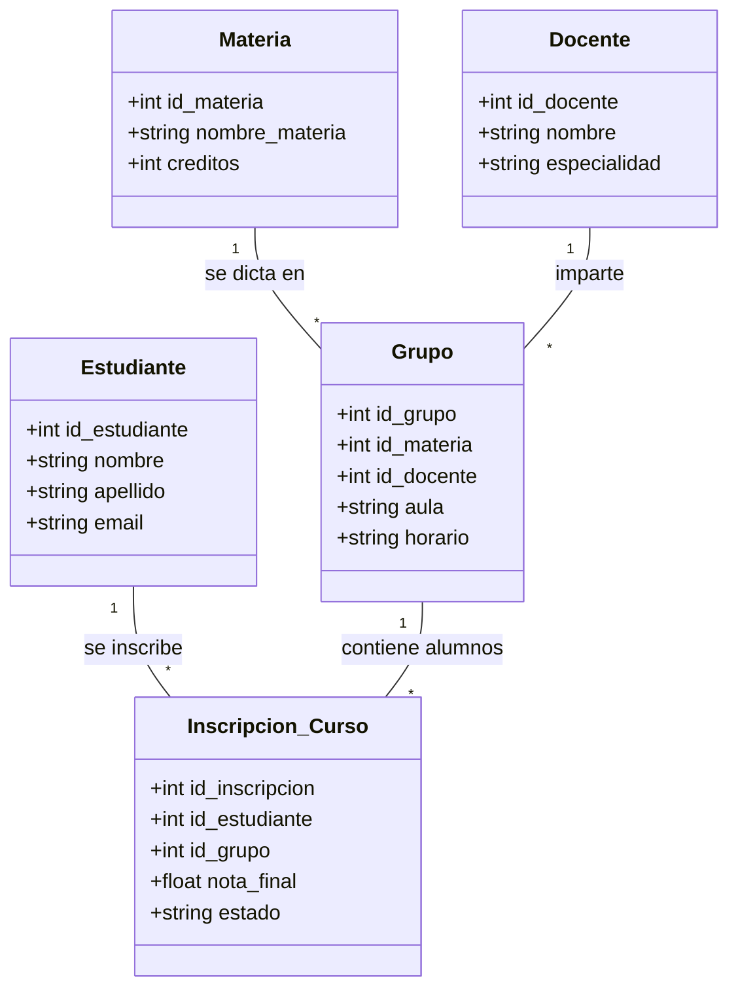

# UNIAJC - Sistema de Gestión Académica (MVC + JDBC)

### Integrantes:
- **Erick Johan Enriquez Vera**
- **John Alexis Correa Cabezas**
- **Deybi Alexander Velasco Coral**

---

## 📌 Descripción del Proyecto
Práctica académica que replica el ecosistema de gestión académica siguiendo la arquitectura en capas: **Modelo, DAO, Servicio, Controlador y Vista** (implementado tanto en interfaz gráfica **Swing** como por **Consola**).

---

## 📊 Diagrama del Ecosistema


---

## 🏗️ Estructura del Proyecto

```
src/main/java/com/uniajc
├── Main.java                         # Punto de entrada de la aplicación (Swing o Consola)
├── config/ConexionPostgresDatabase.java # Gestor de conexión JDBC con soporte SSL para Neon/PostgreSQL
├── db/ConexionDatabase.java
├── seguridad/HashUtil.java           # Encriptación / Funciones Hash SHA-512 y MD5
├── modelo/                           # Entidades: Estudiante, Docente, Materia, Grupo, Inscripcion, Opcion
├── dao/                              # Persistencia JDBC: EstudianteDao, DocenteDao, MateriaDao, GrupoDao, InscripcionDao
├── servicios/                        # Reglas de negocio y validaciones de integridad
├── controlador/                      # Controladores MVC
└── vista/                            # Vistas Swing (VistaPrincipalSwing, Vista<Entidad>Swing) y Vistas Consola
src/main/resources/sql/
├── init.sql                          # Tablas del esquema practica-mvc
└── procedimientos_almacenados.sql    # Procedimientos/Funciones almacenadas (sp_obtener_docentes_combo, sp_obtener_materias_combo)
src/test/java/com/uniajc/             # Pruebas unitarias completas con JUnit 5
```

---

## ⚙️ Configuración de la Base de Datos

1. Ejecutar los scripts SQL en tu servidor PostgreSQL o Neon:
   - `src/main/resources/sql/init.sql`
   - `src/main/resources/sql/procedimientos_almacenados.sql`
2. Copiar `config.properties.example` como `config.properties` en la raíz del proyecto y completar las credenciales:
   ```properties
   db.url=jdbc:postgresql://<HOST>:5432/<DATABASE>?sslmode=require
   db.user=<USUARIO>
   db.password=<CONTRASENA>
   ```

---

## 🚀 Ejecución del Sistema

### Modo Gráfico (Swing):
```bash
mvn compile exec:java -Dexec.mainClass=com.uniajc.Main
```

### Modo Consola:
```bash
mvn compile exec:java -Dexec.mainClass=com.uniajc.Main -Dexec.args=consola
```

### Ejecutar Pruebas Unitarias:
```bash
mvn test
```

---

## 📋 Reglas de Negocio Implementadas
- **Docente y Estudiante:** Nombre mínimo de 2 caracteres, validación de formato de correo único. Integridad referencial: no se pueden eliminar si tienen registros asociados (grupos o inscripciones).
- **Materia:** Nombre único, créditos entre 1 y 10. No se puede eliminar si ya está asignada a un grupo.
- **Grupo:** Docente y materia deben existir. Validación de horarios: no se permite conflicto de aula en el mismo horario ni conflicto de docente en el mismo horario.
- **Inscripción:** Estudiante y grupo deben existir. No se permiten inscripciones duplicadas. La nota se valida entre 0.0 y 5.0. Estados: `ACTIVO` (sin nota), `APROBADO` (nota >= 3.0), `REPROBADO` (nota < 3.0), `CANCELADO`.
- **Criptografía:** `HashUtil` con SHA-512 y MD5 para manejo y validación de contraseñas.
- **Funciones Almacenadas:** `sp_obtener_docentes_combo()` y `sp_obtener_materias_combo()` consumidas mediante `CallableStatement`.
