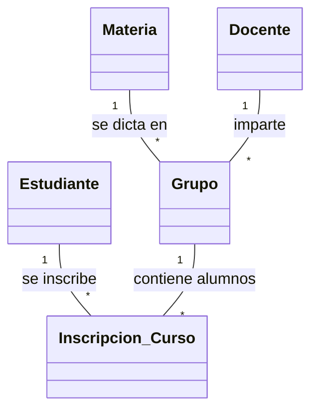

# Sistema de Gestión Académica UNIAJC (MVC + JDBC)

Práctica académica con arquitectura en capas: Modelo, DAO, Servicio, Controlador y Vista (Swing y consola).

## Diagrama



## Estructura

```
src/main/java/com/uniajc
├── Main.java
├── config/ConexionPostgresDatabase.java
├── db/ConexionDatabase.java
├── modelo/        Estudiante, Docente, Materia, Grupo, Inscripcion, Opcion
├── dao/           EstudianteDao, DocenteDao, MateriaDao, GrupoDao, InscripcionDao, DaoException
├── servicios/     EstudianteService, DocenteService, MateriaService, GrupoService, InscripcionService
├── controlador/   ControladorEstudiante, ControladorDocente, ControladorMateria, ControladorGrupo, ControladorInscripcion
└── vista/         PanelCrudSwing, VistaConsola, Vista<Entidad>, Vista<Entidad>Swing, VistaPrincipalSwing, MenuPrincipalConsola
src/main/resources/sql/init.sql
src/test/java/com/uniajc/servicios/   pruebas unitarias de cada servicio
```

## Configuración de la base de datos

1. Ejecutar `src/main/resources/sql/init.sql` en PostgreSQL (Neon).
2. Copiar `config.properties.example` como `config.properties` en la raíz y completar `URL`, `USERNAME` y `PASSWORD`. Este archivo está en `.gitignore` y no debe subirse.

## Ejecución

```bash
mvn clean compile
mvn test
mvn exec:java -Dexec.mainClass=com.uniajc.Main
mvn exec:java -Dexec.mainClass=com.uniajc.Main -Dexec.args=consola
```

## Reglas de negocio

- Estudiante y Docente: nombre mínimo de 2 caracteres, correo válido y único. No se eliminan si tienen inscripciones o grupos.
- Materia: nombre único, créditos entre 1 y 10. No se elimina si tiene grupos.
- Grupo: materia y docente existentes, aula y horario obligatorios. No se permite el mismo aula ni el mismo docente en el mismo horario. No se elimina si tiene inscritos.
- Inscripción: estudiante y grupo existentes, sin duplicados. Nota entre 0.0 y 5.0. ACTIVO sin nota, APROBADO con nota mayor o igual a 3.0, REPROBADO con nota menor a 3.0, CANCELADO libre.
